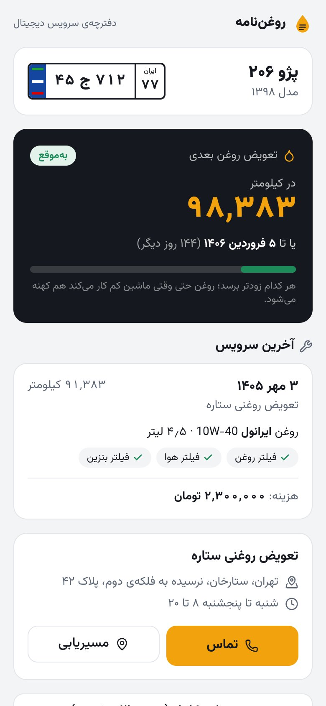
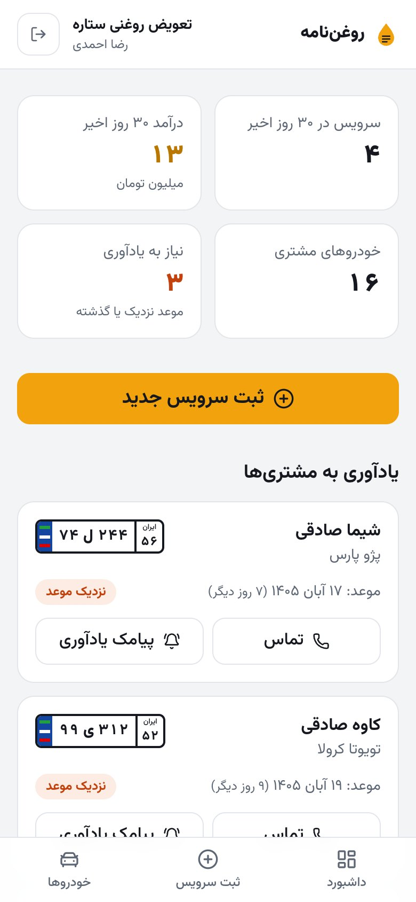
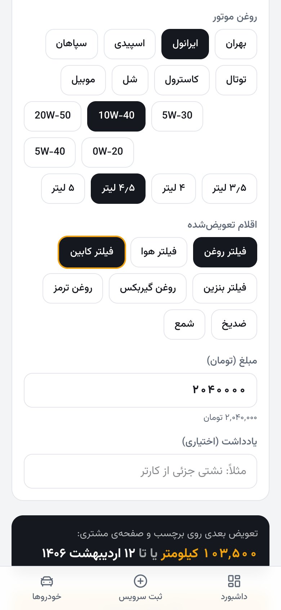
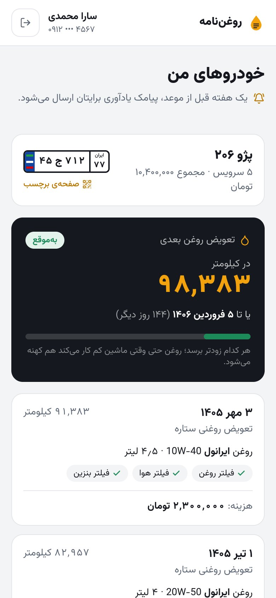
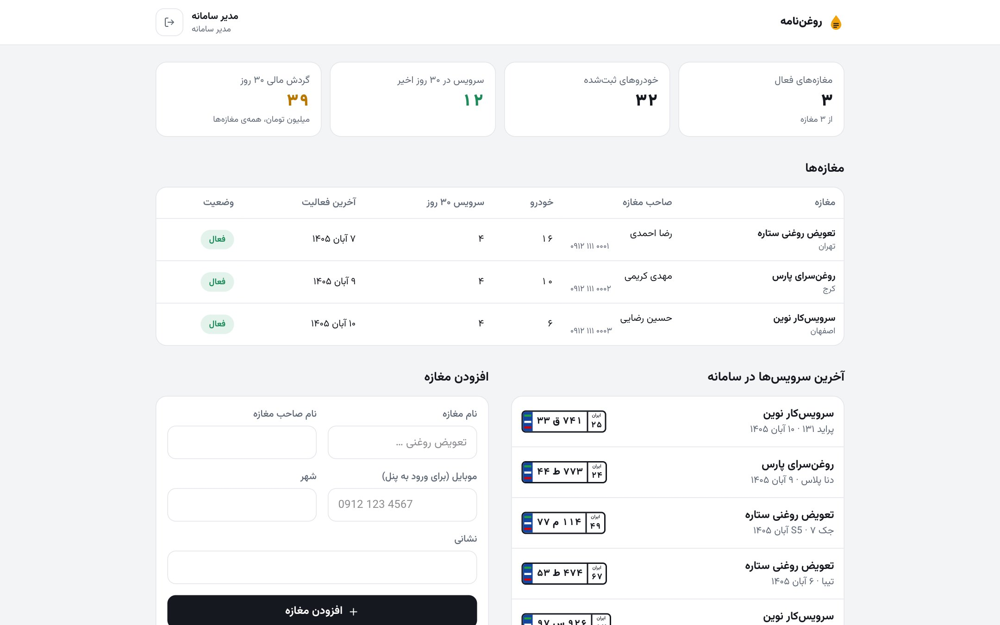

# روغن‌نامه — دفترچه‌ی سرویس دیجیتال خودرو با QR

> A QR-code car service booklet for oil-change shops: a public service card per car, and three role-based dashboards (platform operator, shop owner, customer). Next.js 16 + Prisma.

هر خودرو یک برچسب QR می‌گیرد. با اسکن آن، آخرین تعویض روغن، اقلام مصرفی، هزینه، موعد تعویض بعدی و راه تماس و مسیریابی تا مغازه روی گوشی باز می‌شود؛ بدون نصب برنامه.

> این یک **نمونه‌کار نمایشی** است؛ نام مغازه‌ها، اشخاص، شماره‌ها و نشانی‌ها ساختگی‌اند. روی Vercel داده‌ها هر شب به حالت اول برمی‌گردند.

| اسکن برچسب | داشبورد مغازه | ثبت سرویس | خودروهای مشتری |
|---|---|---|---|
|  |  |  |  |



## نقش‌ها و سطح دسترسی

| | چه می‌بیند | چه کار می‌کند |
|---|---|---|
| **هر کسی که برچسب را اسکن کند** (`/c/<کد>`) | مدل و پلاک، آخرین سرویس، موعد بعدی، مغازه | تماس، مسیریابی (نشان، بلد، گوگل‌مپ، ویز) |
| **مشتری** (`/me`) | همه‌ی خودروهایش و همه‌ی سرویس‌ها، از هر مغازه‌ی عضو | — |
| **صاحب تعویض‌روغنی** (`/shop`) | خودروهایی که در مغازه‌ی خودش سرویس شده‌اند، با نام و موبایل مالک | ثبت سرویس، ثبت خودروی جدید، چاپ برچسب، یادآوری به مشتری |
| **سفارش‌دهنده / مدیر سامانه** (`/admin`) | همه‌ی مغازه‌ها، آمار خودرو، سرویس و گردش مالی | افزودن مغازه، فعال و غیرفعال کردن مغازه |

نام و موبایل مالک و سوابق کامل هیچ‌وقت در صفحه‌ی عمومی اسکن نمی‌آید. ورود همه‌ی نقش‌ها با کد پیامکی است و هر نقش فقط داشبورد خودش را می‌بیند.

## امکانات

- **ثبت سرویس در کمتر از یک دقیقه:** جستجوی خودرو با پلاک (ورودی شبیه پلاک واقعی، با ارقام فارسی یا انگلیسی)، انتخاب روغن و گرید و حجم، تیک اقلام (فیلترها، روغن گیربکس، ضدیخ و…)؛ مبلغ پیشنهادی و موعد بعدی خودکار حساب می‌شود و برند و گرید سرویس قبلی از پیش انتخاب شده است.
- **موعد تعویض بعدی:** بر اساس کیلومتر (۵٬۰۰۰ تا ۱۰٬۰۰۰ بسته به گرید روغن) یا ۶ ماه، هر کدام زودتر.
- **برچسب QR قابل چاپ** (حدود ۹×۶ سانتی‌متر) با موعد بعدی، نام و تلفن مغازه؛ کد برچسب تصادفی و غیرقابل حدس است.
- **یادآوری:** خودروهایی که موعدشان نزدیک یا گذشته است در داشبورد مغازه جدا می‌شوند، با دکمه‌ی تماس و پیامک یادآوری.
- **ورود پیامکی:** در نسخه‌ی نمایشی کد روی صفحه نشان داده می‌شود؛ برای ارسال واقعی کافی است در `requestCode` و `remind` (فایل `app/actions.js`) سرویس پیامکی مثل کاوه‌نگار صدا زده شود.
- فارسی و راست‌به‌چپ، تاریخ شمسی، موبایل‌محور با نوار پایین برای دسترسی با شست، فونت وزیرمتن روی خود هاست.

## اجرا روی کامپیوتر

```bash
npm install
cp .env.example .env   # سپس SESSION_SECRET را عوض کنید
npm run db:setup       # ساخت دیتابیس SQLite و داده‌ی نمونه
npm run dev
```

http://localhost:3000 را باز کنید و از بخش «سه داشبورد» با هر نقش وارد شوید. `npm run db:reset` داده‌ها را به حالت اول برمی‌گرداند.

## انتشار

**Vercel (رایگان):** مخزن را Import کنید، متغیرهای `SESSION_SECRET` و `CRON_SECRET` را بگذارید، از بخش Storage یک دیتابیس **Neon (Postgres)** وصل کنید و Deploy کنید. بیلد (`npm run vercel-build`) دیتابیس را از SQLite به PostgreSQL تغییر می‌دهد، جدول‌ها را می‌سازد و فقط اگر دیتابیس خالی باشد داده‌ی نمونه را وارد می‌کند. Cron در `vercel.json` هر شب ساعت ۳ به وقت تهران نسخه‌ی نمایشی را بازنشانی می‌کند.

**هاست ایرانی:** روی هر سرویسی که Node.js 20.9 به بالا اجرا کند (لیارا، هم‌روش، ابرآروان). `DATABASE_URL` را روی PostgreSQL یا MySQL بگذارید، `provider` را در `prisma/schema.prisma` تغییر دهید و `npm run build` و `npm start` را اجرا کنید. برای نسخه‌ی واقعی، مسیر `/api/cron/reset` و فایل `vercel.json` را حذف کنید.

## ساختار

```
app/
  page.js                 صفحه‌ی اول و ورود نمایشی به سه نقش
  c/[code]/               صفحه‌ی عمومی اسکن برچسب
  login/                  ورود با کد پیامکی
  shop/                   داشبورد مغازه، ثبت سرویس، خودروها، چاپ برچسب
  me/                     داشبورد مشتری
  admin/                  داشبورد مدیر سامانه
  actions.js              همه‌ی Server Actionها (ورود، ثبت سرویس، یادآوری، مغازه‌ها)
  api/cron/reset/         بازنشانی شبانه‌ی نسخه‌ی نمایشی
components/               پلاک، کارت موعد، سابقه‌ی سرویس، قاب داشبوردها
lib/                      دسترسی‌ها (auth)، کاتالوگ روغن و اقلام، قالب‌بندی فارسی، داده‌ی نمونه
prisma/                   مدل داده، داده‌ی نمونه، تغییر خودکار نوع دیتابیس
```

## مراحل بعدی پیشنهادی

- برچسب‌های از پیش چاپ‌شده که با اولین اسکن به خودرو وصل می‌شوند
- اتصال به پنل پیامک و یادآوری خودکار یک هفته قبل از موعد
- اشتراک ماهانه‌ی مغازه‌ها و درگاه پرداخت در داشبورد مدیر سامانه
- گزارش ماهانه‌ی فروش و پرمصرف‌ترین روغن‌ها برای هر مغازه

---

طراحی و توسعه: علی کهرودی
